# Trevsi

> A private photo game for friends traveling together.

**Status:** In development. The core loop is built end to end; a closed beta on Google Play is next.
**Platforms:** Android and web (iOS in testing)

  
  

## What it is

Each day the group gets one photo challenge. Everyone uploads a photo, the group votes, and the winner joins the trip ranking. Only the people on the trip can see it.

## Why it exists

On a group trip, everyone takes hundreds of photos that stay stuck on each phone. The best moments pass, and nobody keeps a shared memory.

## How it works

1. Create a trip: destination, dates and type. Invite people with a link or a code.
2. The daily challenge arrives at the time the group picked, with a countdown.
3. Upload a photo from the camera or the gallery.
4. Vote: one vote per person, and you can't vote for yourself.
5. The winner joins the trip ranking.

## Design decisions

- **Permissions live in the database.** Row Level Security on every table and `SECURITY DEFINER` functions. The phone never decides who can see or do something.
- **The server sets the clock.** `pg_cron` opens and closes each challenge stage using server time and the trip's time zone, never the phone's clock.
- **Zero-cost constraint.** Everything runs on free tiers. I set this as an architecture requirement and built a cost model by scenario.

## How I built it with Claude Code

- **Product first:** one PRD as the single source of truth, a roadmap with exit criteria per milestone, and every architecture decision recorded as an ADR.
- **Claude Code set up as a team:** a `CLAUDE.md` with project rules, path-scoped rules (database, dependencies, packages, security) and four read-only subagents: repo explorer, architect, security reviewer and code reviewer.
- **Review gate:** any change to SQL, permissions, storage or authentication goes through the security reviewer before it lands. I make the final call.
- **Credentials stay out:** they never go through the chat or the repository. I run production deploys and migrations myself.
- **Automated tests:** database permission tests (pgTAP), unit tests and CI on every push.

## Photo upload

1. The server reserves the slot and validates type, size, quota and frequency.
2. The photo goes straight to Cloudflare R2 through a signed URL that fixes the type and size.
3. On completion, the real file content is checked and the photo is moved to its final location.
4. The upload starts as soon as you pick the photo; "Publish" only confirms it.

## Security and privacy

- Private storage with short-lived signed links (15 minutes to 1 hour).
- Invitations use 256-bit tokens, stored hashed. Errors are generic.
- Photos are re-encoded on the phone, so no EXIF data or location is kept.
- Lock-screen notifications never show text written by users.

## Problems I solved

- **iOS uploads failed:** `fetch(file://)` doesn't work there. I moved to `expo-file-system` with binary upload and progress.
- **R2 returned AccessDenied with valid credentials:** the bucket was in the EU jurisdiction, which needs its own endpoint.
- **Challenge times:** each challenge follows the trip's local time, daylight saving changes included.
- **Leaving a group without orphaning it:** row locking against race conditions and an automatic handover of leadership.

## Stack

React Native · Expo · TypeScript · Supabase (Postgres, Auth, Storage, Realtime) · Cloudflare R2 · Next.js · Vitest · GitHub Actions · pnpm

## Numbers

- 8 trip themes, each with its own color
- 2 languages: Spanish and English
- 0 USD per month of infrastructure

---

The source code is private. This repository explains how the project was built, not its code.
Portfolio: https://ignaciomoralesdev.vercel.app
